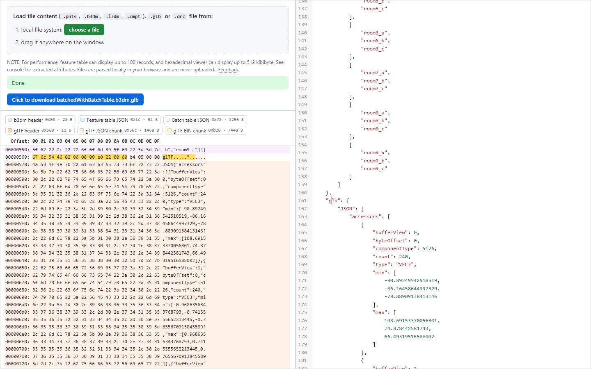
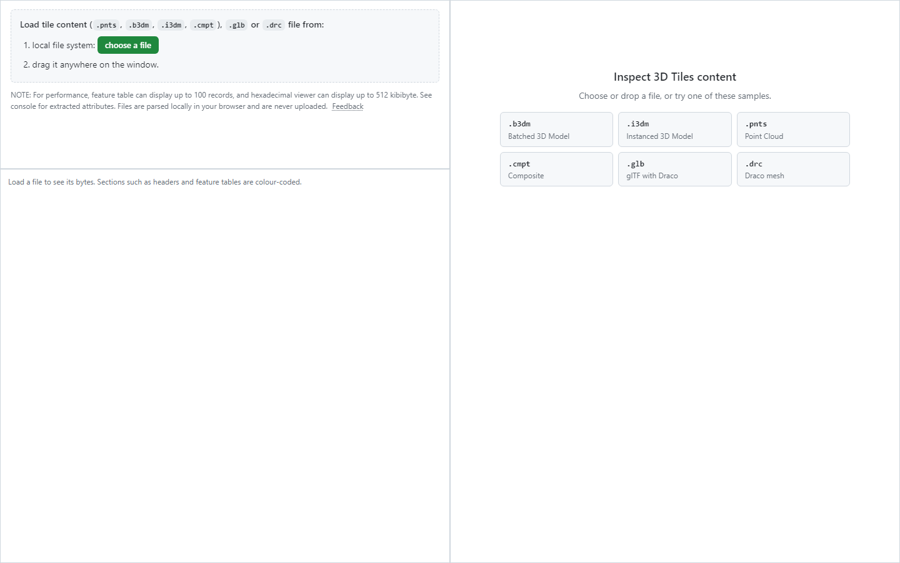

# 3D tile content inspector

Inspect [3D Tiles content](https://github.com/CesiumGS/3d-tiles/blob/main/specification/README.adoc) in the browser: see the parsed structure as JSON, next to a hex view of the bytes.

**Try it: <https://3d-tile-content-inspector.vercel.app/>**

[](https://3d-tile-content-inspector.vercel.app/)

## Supported formats

| Format | Notes |
| --- | --- |
| `.b3dm` | Batched 3D Model, including the embedded glb |
| `.i3dm` | Instanced 3D Model, embedded glb or glTF URI |
| `.pnts` | Point Cloud, including `3DTILES_draco_point_compression` |
| `.cmpt` | Composite, each inner tile is inspected |
| `.glb` | Binary glTF 2.0, including `KHR_draco_mesh_compression` |
| `.drc` | Draco-compressed mesh or point cloud |

## Features

- **Structure and bytes side by side.** The hex view is colour-coded by section (tile header, feature/batch table JSON and binary, glTF header, JSON and BIN chunks), with a legend that jumps to each one.
- **Click a field to find its bytes.** Clicking `featureTableJson`, `batchTableJsonByteLength`, `glb`, ... in the JSON view scrolls the hex view to that section and highlights it. In a `.cmpt`, each tile's fields point at that tile.

  

- **Feature and batch tables decoded.** Binary properties (e.g. `POSITION`, `RGB`, `BATCH_ID`) and Draco-compressed attributes are shown as values.
- **Embedded glb download.** For `.b3dm` and `.i3dm`, the embedded glb can be saved as a separate file.
- **Private.** Files are parsed locally in the browser and never uploaded.

## Usage

Open the app, then load a file in one of these ways:

- **Choose a file**, or **drag it** anywhere onto the window.
- Click one of the **samples** on the start screen.
- Open the app with **`?url=<file URL>`** to load a file directly, for example to share a link:

  ```
  https://3d-tile-content-inspector.vercel.app/?url=https://example.com/tiles/0.b3dm
  ```

  The file is fetched by the browser, so its server must allow cross-origin requests (CORS). If it doesn't, download the file and drop it in instead.



For performance, feature tables show up to 100 records and the hex view shows the first 512 KiB. Extracted glTF attributes are printed to the browser console.

Found a bug or have an idea? Use the **Feedback** link in the app, or [open an issue](https://github.com/bbbbx/3d-tile-content-inspector/issues/new).

## Development

No build step: the app in `src/` runs directly in the browser as ES modules.

Fetch the Draco decoder submodule first; Draco-compressed content can't be decoded without it:

```bash
git submodule update --init --recursive
```

Start a dev server and open <http://127.0.0.1:8080/src>:

```bash
npx http-server
```

Run the end-to-end tests ([Playwright](https://playwright.dev/); a server on port 5504 is started automatically):

```bash
npm test                              # installs browsers, then runs all tests
npx playwright test -g "can inspect b3dm"   # a single test
```

To deploy, serve the `src/` directory as the site root.

## Dependencies

- [Draco](https://github.com/google/draco) (git submodule)
- [CodeMirror 5.59.4](https://codemirror.net/5/)

Both are in `src/thirdParty`. Sample files are listed with their sources and licenses in [`src/samples/README.md`](src/samples/README.md).
